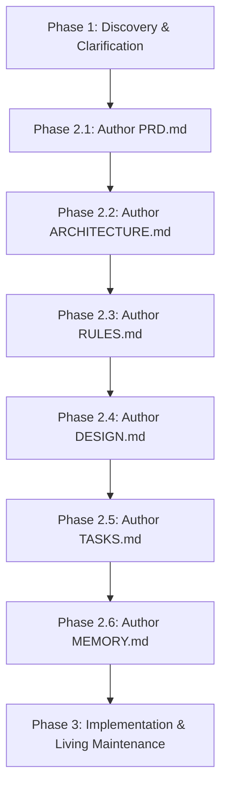

# Project Blueprint

> A structured project initialization and documentation framework for AI coding agents and engineering teams. Generates and maintains the **6 Foundational Project Documents** in a planned, phased sequence before coding begins.

---

## Overview

When coding agents (Google Antigravity, Claude Code, Cursor, Codex) jump straight into writing code without structured architectural artifacts, they suffer from context drift, hallucinated constraints, fragmented styling, and forgotten decisions between sessions.

`project-blueprint` enforces a disciplined specification-first methodology. It equips agents with standard templates and a phased generation order to bootstrap comprehensive project documentation.

---

## The 6 Foundational Documents

```
<project-root>/
└── docs/ (or root ./)
    ├── PRD.md            # What to build and why (features, user flows, non-goals)
    ├── ARCHITECTURE.md   # How it is built (tech stack, data models, folder tree)
    ├── RULES.md          # Guardrails, idioms, constraints, and strict Do's & Don'ts
    ├── DESIGN.md         # UI/UX design tokens, layout hierarchy, component states
    ├── TASKS.md          # Phased milestones with atomic vertical tracer bullets
    └── MEMORY.md         # ADRs, toolchain gotchas, debugging logs, session handoffs
```

### 1. `PRD.md` (Product Requirements Document)
* **Purpose:** Defines the core product vision, problem statement, and user personas.
* **Key Content:** P0 (MVP), P1, and P2 feature breakdowns, user flow diagrams, measurable KPIs, and explicit out-of-scope non-goals to prevent feature creep.
* **Template:** [`templates/PRD.template.md`](templates/PRD.template.md)

### 2. `ARCHITECTURE.md` (System Architecture)
* **Purpose:** Translates PRD requirements into technical solutions.
* **Key Content:** System overview (Mermaid diagram), tech stack decision matrix with trade-offs, domain models & ER diagram, data flow/state lifecycle, annotated folder structure, external API integration contracts, and security/secret boundaries.
* **Template:** [`templates/ARCHITECTURE.template.md`](templates/ARCHITECTURE.template.md)

### 3. `RULES.md` (Engineering Guardrails)
* **Purpose:** Sets the project-specific coding standards and architectural guardrails.
* **Key Content:** Deep module philosophy, test-at-seams mandate, strict Do's & Don'ts table (state, architecture, styling, error handling, dependencies), code style conventions, and conventional commit rules.
* **Template:** [`templates/RULES.template.md`](templates/RULES.template.md)

### 4. `DESIGN.md` (UI/UX & Component System)
* **Purpose:** Establishes cohesive visual identity and eliminates generic "AI boilerplate" styling.
* **Key Content:** Design tokens (dark/light color palettes, 8-pt typography scale, 4dp/8dp spacing, corner radii, elevation), complete 7-state component matrix (default, hover, active, disabled, loading, empty, error), anti-AI-slop rules, harmonized with [`open-design-agent-kit`](../open-design-agent-kit/SKILL.md).
* **Template:** [`templates/DESIGN.template.md`](templates/DESIGN.template.md)

### 5. `TASKS.md` (Implementation Checklist)
* **Purpose:** Breaks down the project into vertical, testable tracer bullets.
* **Key Content:** Phased milestones (M0: Scaffolding ➔ M1: Domain ➔ M2: Seams ➔ M3: UI ➔ M4: State/Integrations ➔ M5: Verification), atomic checkbox tasks (`- [ ]`/`- [x]`), dependencies, and an active in-flight work tracker.
* **Template:** [`templates/TASKS.template.md`](templates/TASKS.template.md)

### 6. `MEMORY.md` (Living Session Log)
* **Purpose:** Provides persistent memory across agent sessions.
* **Key Content:** Architectural Decision Records (ADRs with trade-offs), environment and platform quirks, resolved debugging logs (symptom, root cause, fix), and session handoff notes.
* **Template:** [`templates/MEMORY.template.md`](templates/MEMORY.template.md)

---

## Phased Execution Pipeline

Agents follow a strict generation order so downstream decisions build upon established foundations:



---

## Living Document Maintenance Loop

During active development, agents keep these documents current:
* **`TASKS.md`**: Completed tasks are checked off immediately after verification (`- [x]`). The `Active Work Item` section is refreshed at the start and end of every turn.
* **`MEMORY.md`**: Whenever a non-trivial architectural choice, workaround, or platform gotcha is encountered, it is logged in `MEMORY.md`.
* **`RULES.md`**: If a new bug pattern or code smell is identified, a corresponding rule is added to prevent regressions.

---

## Usage

* **Trigger Phrases:** `"create project blueprint"`, `"scaffold project docs"`, `"plan this project"`, `"initialize project documentation"`.
* **Global Rule:** Configured permanently across `~/.gemini/config/GEMINI.md`, `CLAUDE.md`, and `~/.agents/rules/project-documentation-standard.md`.
