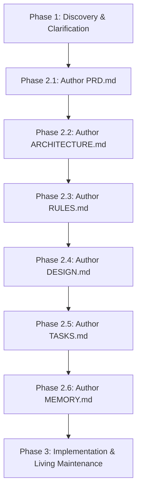

# Project Blueprint: Structured Documentation & Architecture Framework

The **`project-blueprint`** skill establishes a structured, predictable, and disciplined foundation for any software project or application. Instead of generating ad-hoc code or dumping disconnected markdown files, this skill guides agents through authoring and maintaining the **6 Foundational Project Documents** in a logical, phased sequence.

---

## The 6 Foundational Documents

Every project planned with this skill produces and maintains these six interconnected documents:

| Document | Primary Purpose | Key Contents |
| :--- | :--- | :--- |
| **`PRD.md`** | **Product Requirements** | Vision, problem statement, personas, P0/P1/P2 features, user flows, KPIs, and non-goals. |
| **`ARCHITECTURE.md`** | **System & Technical Design** | System diagrams, tech stack rationale, data models, state lifecycle, folder structure, API boundaries, security. |
| **`RULES.md`** | **Engineering Guardrails** | Core principles, language idioms, architecture constraints, strict Do's & Don'ts table, error handling, git conventions. |
| **`DESIGN.md`** | **UI/UX & Component System** | Visual identity, design tokens (colors, typography, spacing, elevation), full component state matrix, anti-slop guidelines. |
| **`TASKS.md`** | **Implementation Checklist** | Phased milestones, vertical tracer-bullet tasks with checkboxes (`[ ]`/`[x]`), dependencies, and active work item tracker. |
| **`MEMORY.md`** | **Living Session Log** | Architectural Decision Records (ADRs), environment/platform quirks, debugging notes, and session handoffs. |

---

## Phased Execution Workflow

When invoked to plan a new project, scaffold an existing repository, or structure documentation, agents must follow this sequential process:



### Phase 1: Discovery & Scope Calibration
Before writing any file, establish ground truth:
1. Clarify the core value proposition: What exact problem does this application solve?
2. Identify the target platform: Android (Jetpack Compose / XML), Flutter, Web (React, Next.js, Vue), CLI, or Backend service.
3. Determine constraints: Offline-first, performance budgets, auth mechanisms, external APIs.
*(Tip: If requirements are ambiguous, invoke the `/grilling` or `grill-me` skill to resolve decisions before documenting).*

### Phase 2: Sequential Document Generation
Generate each file in strict dependency order, using the bundled templates in `templates/`:

1. **`PRD.md`**: Defines *what* is being built and *why*. Sets explicit non-goals (Out of Scope) to prevent feature creep.
2. **`ARCHITECTURE.md`**: Translates PRD requirements into technical solutions. Establishes the folder tree, data models, state lifecycle, and external adapters.
3. **`RULES.md`**: Locks in technical constraints, prohibited patterns, and coding standards tailored to the tech stack chosen in ARCHITECTURE.md.
4. **`DESIGN.md`**: Enforces visual tokens, layout hierarchies, and anti-AI-slop standards. Directly applies the global `open-design-agent-kit` guidelines for frontend and mobile apps.
5. **`TASKS.md`**: Breaks the architecture into vertical, testable milestone slices (Milestone 0 through 5). Every task has a clear acceptance criterion.
6. **`MEMORY.md`**: Initializes the living session log with baseline ADRs, toolchain prerequisites, and the first session focus.

### Phase 3: Living Document Maintenance Loop
During active coding sessions, agents must maintain these documents dynamically:
* **`TASKS.md`**: Check off completed items (`- [x]`) immediately after verification. Update the `Active Work Item` section at the top on every turn.
* **`MEMORY.md`**: Record any new architectural decision, non-obvious workaround, or platform gotcha encountered during debugging.
* **`RULES.md`**: Append new guardrails if an anti-pattern or recurring bug is discovered during development.

---

## Placement & Storage Strategy

By default, place these documents in a dedicated `docs/` folder at the repository root, or at the root if requested by the project conventions:

```
<project-root>/
├── docs/ (or root ./)
│   ├── PRD.md
│   ├── ARCHITECTURE.md
│   ├── RULES.md
│   ├── DESIGN.md
│   ├── TASKS.md
│   └── MEMORY.md
```

If the project uses an AI workspace harness (e.g. `.agents/`), add context pointers to these files in `AGENTS.md` or `GEMINI.md`.

---

## Bundled Template References

The skill bundles production-ready templates located in the `templates/` directory:
* [`templates/PRD.template.md`](templates/PRD.template.md)
* [`templates/ARCHITECTURE.template.md`](templates/ARCHITECTURE.template.md)
* [`templates/RULES.template.md`](templates/RULES.template.md)
* [`templates/DESIGN.template.md`](templates/DESIGN.template.md)
* [`templates/TASKS.template.md`](templates/TASKS.template.md)
* [`templates/MEMORY.template.md`](templates/MEMORY.template.md)
