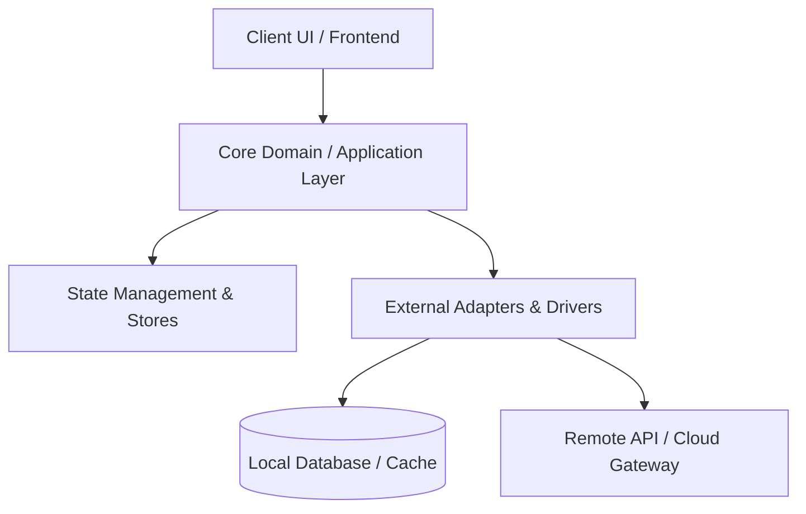
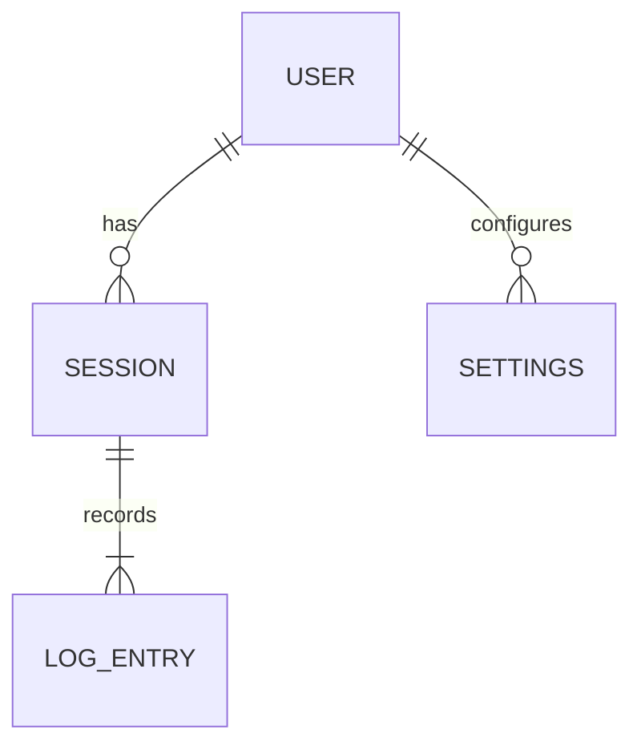

# System Architecture & Technical Design

**Project Name:** [Project Name]  
**Architecture Version:** [1.0.0]  
**Last Updated:** [YYYY-MM-DD]

---

## 1. High-Level Architecture Overview



* **Architectural Style:** [e.g., Clean Architecture, Modular Monolith, Local-First Reactive, Microservices]
* **Design Philosophy:** [e.g., Deep modules with small interfaces; separation of pure logic from platform adapters]

---

## 2. Tech Stack & Decision Matrix

| Layer | Technology | Version | Rationale & Trade-offs |
| :--- | :--- | :--- | :--- |
| **Language** | [e.g. Kotlin / TypeScript / Go] | [x.y] | [Why chosen over alternatives] |
| **UI Framework** | [e.g. Jetpack Compose / React / Flutter] | [x.y] | [Reactive ergonomics, component ecosystem] |
| **State Management** | [e.g. ViewModel + StateFlow / Zustand] | [x.y] | [Predictable unidirectional data flow] |
| **Persistence / DB** | [e.g. Room / SQLite / Postgres / Prisma] | [x.y] | [ACID compliance, offline capability] |
| **Networking / API**| [e.g. Ktor / Retrofit / Fetch / Axios] | [x.y] | [Type safety, connection pooling] |
| **Testing** | [e.g. JUnit5 / Mockk / Vitest / Playwright]| [x.y] | [Fast execution at public seams] |

---

## 3. Data Architecture & Schema

### Domain Models
```
Entity: UserProfile
  - id: UUID (Primary Key)
  - email: String (Unique)
  - preferences: JSON / Embedded
  - createdAt: Timestamp
```

### Entity-Relationship Diagram


---

## 4. Data Flow & State Lifecycle
1. **Unidirectional Data Flow (UDF):** User interaction triggers an Event/Intent ➔ Reducer/UseCase processes event ➔ State updated immutably ➔ View reacts to new State.
2. **Persistence Strategy:** Cache-first reads with background revalidation. Mutations update local store optimistically before external synchronization.

---

## 5. Folder & Directory Structure

```
project-root/
├── docs/                  # Project specifications and architecture diagrams
│   ├── PRD.md
│   ├── ARCHITECTURE.md
│   ├── RULES.md
│   ├── DESIGN.md
│   ├── TASKS.md
│   └── MEMORY.md
├── src/ (or app/)
│   ├── domain/            # Pure business entities and use-cases (no framework code)
│   ├── data/              # Repositories, data sources, database schemas, API clients
│   ├── ui/                # Views, screens, composables/components
│   │   └── theme/         # Design tokens, color schemes, typography
│   └── common/            # Shared utilities, extensions, typed error wrappers
├── tests/                 # Unit, integration, and E2E test suites
└── scripts/               # Automation, dev server, and build scripts
```

---

## 6. Integration Boundaries & External APIs
* **Boundary 1:** [Contract definition, serialization format, timeout/retry policy, circuit breaker]
* **Boundary 2:** [Authentication mechanism, API key rotation, mock adapter for offline testing]

---

## 7. Security, Auth & Secrets Handling
* **Secret Storage:** Never store API keys or tokens in git. Use `.env.local`, system keystores (Keychain / Android Keystore), or process environment variables.
* **Input Sanitization:** All boundary inputs validated against strict schemas before passing to domain layer.
* **Least Privilege:** Cloud/database connections bound to the minimum required scopes.
