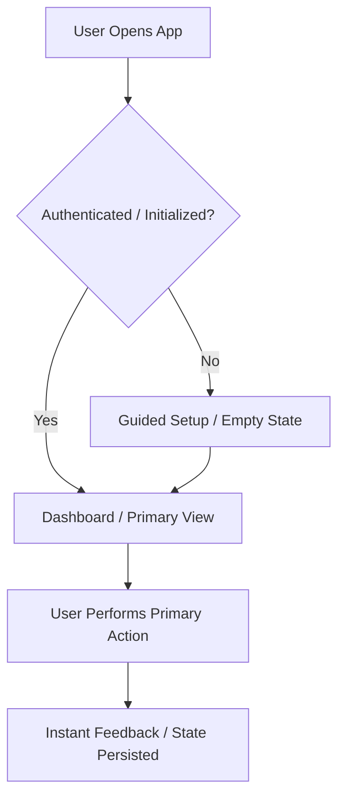

# Product Requirements Document (PRD)

**Project Name:** [Project Name]  
**Status:** [Draft | In Review | Approved]  
**Last Updated:** [YYYY-MM-DD]  
**Author(s):** [Author / Team]

---

## 1. Executive Summary & Vision
* **Vision Statement:** [A 1-2 sentence compelling summary of what the product does and why it exists.]
* **Primary Value Proposition:** [Why users choose this solution over alternatives.]

---

## 2. Problem Statement & Target Audience
* **The Problem:** [What core pain point, inefficiency, or friction is being resolved?]
* **Target Users / Personas:**
  * **Primary Persona:** [Role, goals, technical comfort level, key frustrations.]
  * **Secondary Persona:** [Stakeholders, administrators, or incidental users.]

---

## 3. Goals & Success Metrics
* **Key Business / Technical Goals:**
  1. [Goal 1: e.g. Provide a sub-100ms local utility for daily device monitoring]
  2. [Goal 2: e.g. Zero-cloud dependency for core functionality]
* **Measurable KPIs:**
  * [Metric 1: e.g. App cold startup < 800ms]
  * [Metric 2: e.g. 100% test coverage on business logic seams]

---

## 4. Feature Specifications & Prioritization

### P0 — Must-Have (MVP)
*Critical for the initial usable release. The app cannot ship without these.*
* **Feature 1:** [Description, acceptance criteria, expected user experience.]
* **Feature 2:** [Description, acceptance criteria, expected user experience.]

### P1 — High Priority (Fast Follow)
*Important features that complete the core workflow but are non-blocking for initial sandbox use.*
* **Feature 3:** [Description, rationale.]

### P2 — Nice to Have (Future Enhancements)
*Delight features, polish, or extended integrations planned for subsequent releases.*
* **Feature 4:** [Description.]

---

## 5. User Flows & Scenarios

* **Happy Path Scenario:** [Step-by-step user journey from entry to task completion.]
* **Edge Case / Error Path:** [What happens when network drops, data is corrupted, or permissions are denied.]

---

## 6. Non-Functional Requirements (NFRs)
* **Performance:** [Latency targets, memory footprint, bundle size limits.]
* **Reliability & Offline-First:** [Local cache behavior, optimistic UI updates.]
* **Security & Privacy:** [Local credential storage, token handling, zero external telemetry if private.]
* **Compatibility:** [OS versions, screen resolutions, minimum hardware specs.]

---

## 7. Out of Scope (Non-Goals)
*Explicitly list what the product will NOT do in this iteration to prevent scope creep:*
* ❌ [Explicit non-goal 1]
* ❌ [Explicit non-goal 2]
